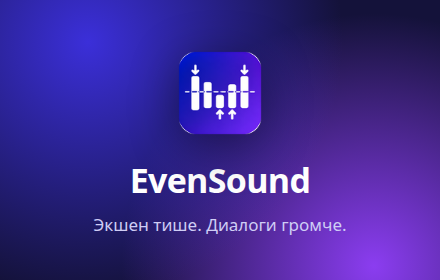
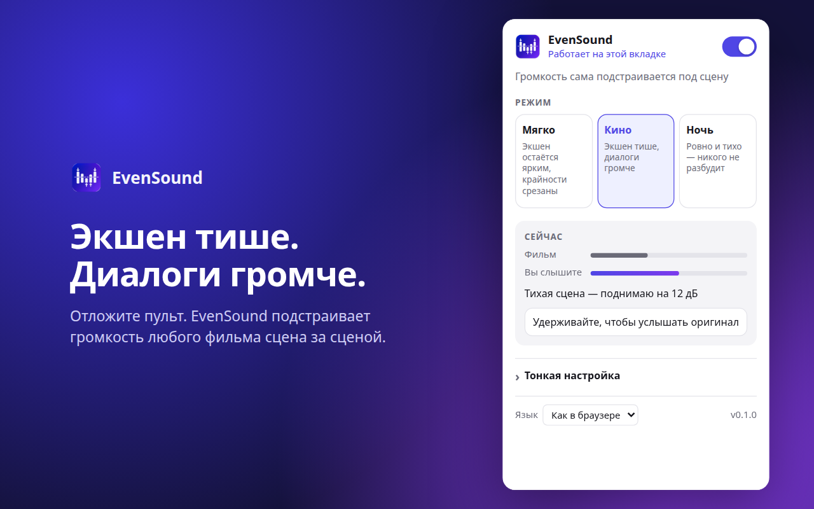
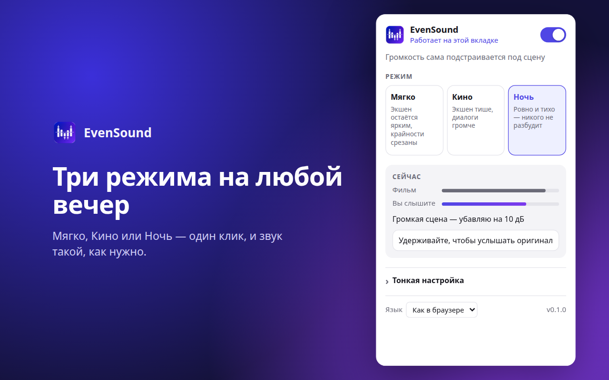
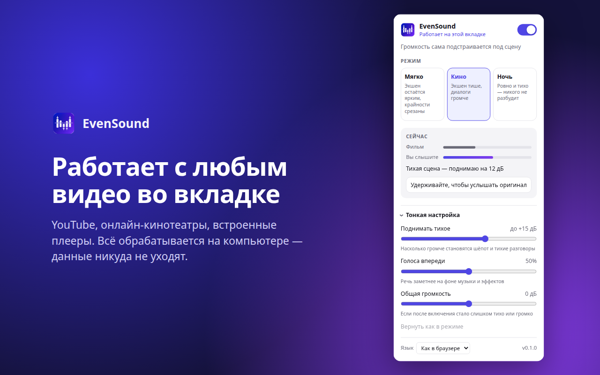

# EvenSound

<p align="center"></p>

Расширение Chrome, которое выравнивает громкость фильмов: экшен тише, диалоги громче.
Захватывает весь звук вкладки, поэтому работает с любым плеером — YouTube,
встроенные плееры на сайтах, iframe.

<p align="center">
  
  
  
</p>

## Установка

1. Взять папку с расширением (или распаковать ZIP из `dist/`).
2. Открыть `chrome://extensions`, включить «Режим разработчика».
3. «Загрузить распакованное расширение» → выбрать папку.
4. Закрепить значок расширения на панели (иконка пазла → булавка).

## Использование

Открыть вкладку с фильмом → нажать значок (или `Alt+Shift+L`) → включить переключатель.
На значке появится `ON`. Включать нужно отдельно для каждой вкладки.

- **Мягко** — небольшое выравнивание, экшен почти как в оригинале.
- **Кино** — экшен заметно тише, диалоги громче.
- **Ночь** — почти ровный звук, речь вперёд.
- «Удерживайте, чтобы услышать оригинал» — оригинал на той же общей громкости, для честного сравнения.
- «Тонкая настройка» — подъём тихих сцен, выделение голоса, общая громкость.

Интерфейс: русский, английский, испанский, португальский, французский, немецкий.

Громкость телевизора выставляется один раз под диалог.

## Как устроено

`popup` получает id потока вкладки (`chrome.tabCapture`) → `offscreen`-документ
захватывает звук и пропускает его через AudioWorklet (`worklet.js` → `dsp.js`):

1. Фокус на речи: середина стерео (там диалоги) подчёркивается, края приглушаются, подъём ~2.5 кГц.
2. Выравниватель: скользящее окно 0.4 с, тянет уровень к −20 дБ.
3. Компрессор для быстрых пиков (выстрелы, удары).
4. Лимитер с предпросмотром 5 мс, потолок −1 дБ.

## Сборка

```
./build.sh
```

Прогоняет тесты и собирает ZIP для Chrome Web Store в `dist/`.

## Тесты

```
npm test
```

Прогоняют DSP на синтетическом «фильме» (диалог → бой → диалог).

## Ограничения

- Сайты с DRM (Netflix и т.п.) могут отдавать тишину при захвате — не проверялось.
- Пока вкладка захвачена, Chrome показывает индикатор захвата у вкладки.
- Полноэкранное видео остаётся внутри окна браузера; помогает F11.

## Конфиденциальность

Звук обрабатывается локально и никуда не отправляется. Политика:
https://fest322.github.io/evensound-privacy/
